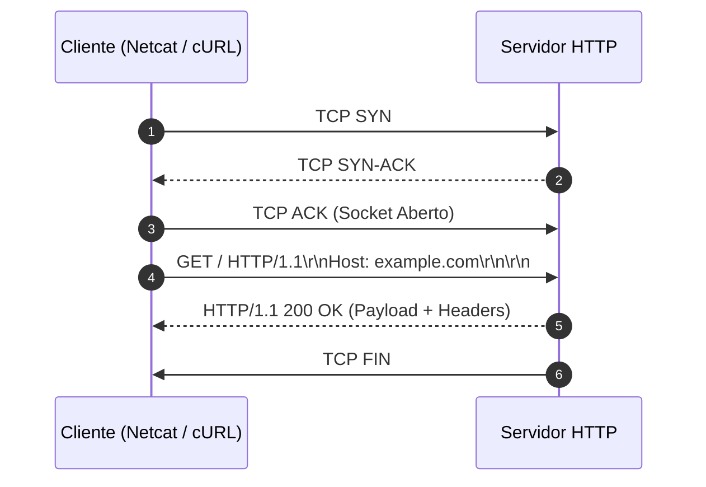

# Memória de Desenvolvimento — Semana 01: Protocolo HTTP & Sockets Bare-Metal
**Aluno:** Luana Laurenço dos Santos   
**Matrícula:** 202411200240
**Curso:** Sistemas de Informação

---

## 1. Mapeamento da Camada de Transporte
Diagrama Mermaid demonstrando o ciclo de vida da requisição executada no laboratório:

---

## 2. Registro dos Experimentos de Laboratório

### Experimento 1: Netcat Nu & Falha 400 Bad Request
* **Comando Testado:** `nc -C example.com 80` sem o header `Host:`
* **Resultado:** O servidor retorna o código de status 400 Bad Request (Requisição Inválida). 
Isso ocorre porque, no protocolo HTTP/1.1, o cabeçalho Host é obrigatório. 
Como os servidores modernos utilizam Virtual Hosting (hospedam vários sites/domínios no mesmo endereço IP), o servidor precisa desse campo para saber exatamente qual site (qual pasta/arquivo) deve entregar. Sem ele, a requisição é rejeitada por ambiguidade.
### Experimento 2: Semântica dos Métodos HTTP
* **Análise dos Verbos:** Explique a diferença observada entre chamadas `GET`, `POST` e `OPTIONS`.
GET: Usado para recuperar dados do servidor (somente leitura). Não deve alterar o estado do servidor.
POST: Usado para enviar dados ao servidor (geralmente para criar ou processar algo). Costuma ter um corpo de requisição (payload).
OPTIONS: Usado para descobrir quais métodos e capacidades o servidor suporta para um determinado recurso (muito usado em CORS e requisições "pre-flight").

* **Header Content-Length:** Como o tamanho do payload afeta a leitura no buffer do socket?
O servidor e o cliente usam o Content-Length para saber exatamente quantos bytes compõem o corpo (payload) da mensagem. 
No modelo Bare-Metal (socket puro), sem esse header, o servidor não saberia quando o cliente terminou de enviar os dados (onde acaba a mensagem), podendo travar esperando mais bytes no buffer TCP.

### Experimento 3: URL, Query Strings & Percent-Encoding
* **URL Testada: (Passo 1)** curl -v http://httpbin.org/get?curso=Engenharia da Computacao
* **URL Testada: (Passo 2)** curl -v https://httpbin.org/get?curso=Engenharia%20da%20Computa%C3%A7%C3%A3o
* **O erro no Passo 1:** O que o terminal retornou ao tentar rodar a URL com espaços reais?
O terminal (e a biblioteca de rede) retorna um erro de URL malformada (geralmente curl: (3) URL using bad/illegal format or missing URL). 
O terminal interpreta o espaço em branco como o fim do comando e tenta executar a palavra "da" como um comando separado, quebrando a chamada.

* **A função do `%20`:** Explique de forma simples por que somos obrigados a substituir espaços e caracteres especiais (como acentos) por códigos com `%` nas URLs.
A URL foi projetada para ser transmitida na rede seguindo um padrão estrito de caracteres permitidos (ASCII visível). Espaços, acentos e símbolos (como ç) não são permitidos na sintaxe da URL. 
O Percent-Encoding transforma esses caracteres em seus equivalentes em código hexadecimal seguros para o tráfego, como o %20 (espaço) e %C3%A7 (ç).

### Experimento 4: Negociação de Conteúdo & User-Agent
* **Análise:** Como o servidor reage ao receber diferentes cabeçalhos `Accept` e `User-Agent`?
O servidor analisa os headers para fazer Content Negotiation (Negociação de Conteúdo). O header Accept diz ao servidor qual formato de arquivo o cliente prefere (ex: application/json ou text/html); se o servidor puder atender, ele responde naquele formato. 
O User-Agent identifica o cliente (navegador, sistema operacional ou bot), permitindo que o servidor adapte a resposta (ex: entregar uma página mobile, bloquear bots maliciosos ou retornar respostas específicas para o curl).

### Experimento 5: Redirecionamentos & Cache Condicional
* **Redirecionamento (301):** Qual a diferença ao executar `curl -I` com e sem a flag `-L`?
O comando curl -I faz um request do tipo HEAD e exibe apenas os headers da resposta. Se a URL for uma página movida, ele retorna o código 301 Moved Permanently e o header Location. 
Ao adicionar a flag -L, o curl se comporta como um navegador, seguindo o link do header Location automaticamente e exibindo a resposta final (do novo endereço).

* **Validação de Cache (304):** Explique como o header `If-None-Match` e a `ETag` evitam retransmissão de dados na rede.
Para economizar banda, o servidor envia uma ETag (uma "impressão digital" do arquivo) na primeira requisição. Na próxima vez que o cliente pedir a mesma página, ele envia o header If-None-Match contendo a ETag antiga. 
Se o arquivo não mudou no servidor, ele responde com 304 Not Modified (sem corpo). O navegador então usa a cópia que já tem salva no cache local.
---

## 3. Conclusão Técnica
Compreender a transmissão de bytes ASCII e a sintaxe CRLF (Carriage Return + Line Feed) é fundamental, pois revela que a Web não é "mágica", mas sim um protocolo estrito de comunicação textual sobre uma conexão TCP. 
O servidor lê o socket byte a byte, buscando a sequência \r\n\r\n para saber onde os headers terminam e o corpo começa.

Dominar esse nível bare-metal capacita o engenheiro a projetar sistemas distribuídos e de alta performance. 
Saber como funciona o cache (ETag/304), a negociação de headers, a semântica dos verbos HTTP e o gerenciamento de buffers (Content-Length) permite construir APIs mais seguras, eficientes e com menor tráfego de rede, além de facilitar drasticamente o diagnóstico de problemas em sistemas complexos de backend.
