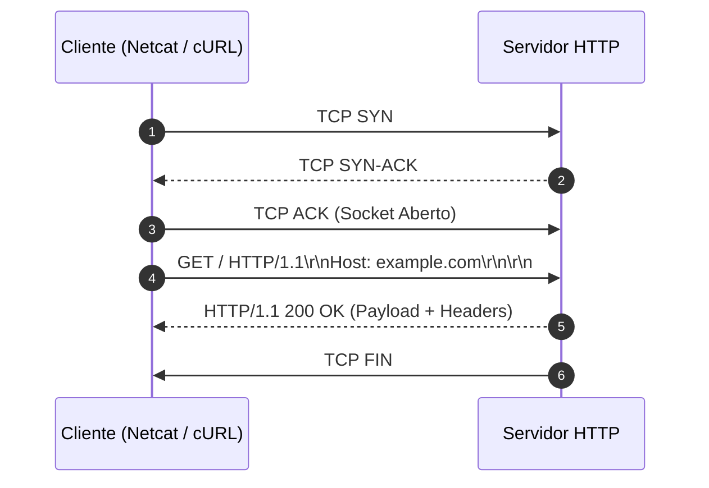

# Memória de Desenvolvimento — Semana 01: Protocolo HTTP & Sockets Bare-Metal
**Aluno:** Luana Laurenço dos Santos
**Matrícula:** 202411200240  
**Curso:** Sistemas de Informação

---

## 1. Mapeamento da Camada de Transporte
Diagrama Mermaid demonstrando o ciclo de vida da requisição executada no laboratório:

## 2. Registro dos Experimentos de Laboratório

### Experimento 1: Netcat Nu & Falha 400 Bad Request
* **Comando Testado:** `nc -C example.com 80` sem o header `Host:`
* **Resultado:** O servidor pode retornar o código 400 Bad Request, que indica que a requisição está incorreta ou incompleta. O campo Host é obrigatório no HTTP/1.1 porque permite identificar o domínio solicitado. Isso é necessário porque vários sites podem utilizar o mesmo endereço IP, e o servidor precisa saber qual deles deve responder à requisição.

### Experimento 2: Semântica dos Métodos HTTP
* **Análise dos Verbos:** O método GET é utilizado para solicitar informações de um servidor. O método POST é utilizado para enviar dados ao servidor, como informações de um formulário. Já o método OPTIONS permite consultar quais métodos e opções de comunicação são suportados pelo servidor ou por determinado recurso.

* **Header Content-Length:** O cabeçalho Content-Length informa o tamanho do corpo da mensagem em bytes. Ele ajuda a aplicação a identificar quantos bytes precisam ser lidos para receber o conteúdo completo. Se o tamanho estiver incorreto ou a leitura não for controlada adequadamente, a aplicação poderá receber apenas parte dos dados ou interpretar a mensagem de forma incorreta.

### Experimento 3: URL, Query Strings & Percent-Encoding
* **URL Testada: (Passo 1)** curl -v http://httpbin.org/get?curso=Engenharia da Computacao
* **URL Testada: (Passo 2)** curl -v https://httpbin.org/get?curso=Engenharia%20da%20Computa%C3%A7%C3%A3o
* **O erro no Passo 1:** O cURL pode apresentar um erro de URL inválida, pois os espaços não codificados podem impedir a interpretação correta do endereço. Além disso, o terminal pode interpretar os espaços como separadores entre argumentos do comando, caso a URL não esteja entre aspas.
* **A função do `%20`:** Precisamos utilizar o percent-encoding para representar espaços e caracteres especiais de maneira padronizada. Por exemplo, %20 representa um espaço, enquanto %C3%A7 representa a letra ç em UTF-8. Isso permite que a URL seja interpretada corretamente e que os parâmetros sejam transmitidos sem ambiguidades.

### Experimento 4: Negociação de Conteúdo & User-Agent
* **Análise:** Como o servidor reage ao receber diferentes cabeçalhos `Accept` e `User-Agent`?
O cabeçalho Accept informa quais formatos de conteúdo o cliente aceita, como JSON ou HTML. O servidor pode utilizar essa informação para escolher o formato da resposta. Já o cabeçalho User-Agent identifica o cliente que realizou a requisição, como um navegador ou o cURL. O servidor pode utilizar essas informações para adaptar respostas ou registrar acessos. O comportamento depende da configuração do servidor.
### Experimento 5: Redirecionamentos & Cache Condicional
* **Redirecionamento (301):** Qual a diferença ao executar `curl -I` com e sem a flag `-L`? O comando curl -I solicita apenas os cabeçalhos da resposta. Sem a opção -L, o cURL mostra os cabeçalhos da resposta inicial, incluindo o redirecionamento 301, sem seguir automaticamente para o novo endereço. Com a opção -L, o cURL segue os redirecionamentos e mostra os cabeçalhos das respostas recebidas durante o processo.
* **Validação de Cache (304):** Explique como o header `If-None-Match` e a `ETag` evitam retransmissão de dados na rede.
A ETag identifica uma versão de determinado recurso. Quando o cliente armazena esse recurso em cache, pode enviar a ETag na próxima requisição por meio do cabeçalho If-None-Match. Se o conteúdo não tiver mudado, o servidor pode responder com 304 Not Modified, indicando que o cliente pode utilizar a cópia armazenada sem baixar novamente todo o conteúdo. Isso economiza largura de banda e melhora o desempenho.
---

## 3. Conclusão Técnica
[Descreva em 1-2 parágrafos a importância de compreender a transmissão de bytes ASCII e a sintaxe CRLF na camada de aplicação para desenvolvimento de sistemas distribuídos e de alta performance.]

Compreender a transmissão de bytes na camada de aplicação é importante para desenvolver sistemas distribuídos que se comuniquem de maneira eficiente e confiável. O protocolo HTTP utiliza mensagens estruturadas, compostas por cabeçalhos e, quando necessário, um corpo com os dados transmitidos. Conhecer essa estrutura ajuda a identificar erros de comunicação e a implementar corretamente clientes e servidores.

A sintaxe CRLF, representada por \r\n, é utilizada para delimitar as linhas dos cabeçalhos HTTP e separar os cabeçalhos do corpo da mensagem. Entender esses delimitadores e controlar corretamente os bytes enviados e recebidos ajuda a evitar erros de interpretação, melhorar o desempenho da comunicação e garantir a compatibilidade entre diferentes sistemas.

